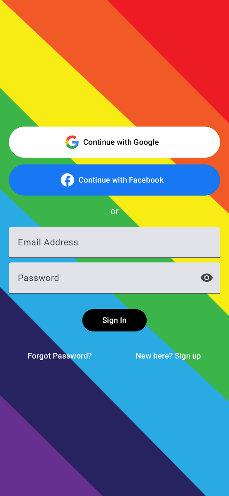
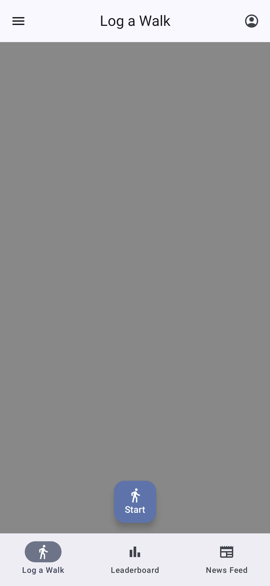
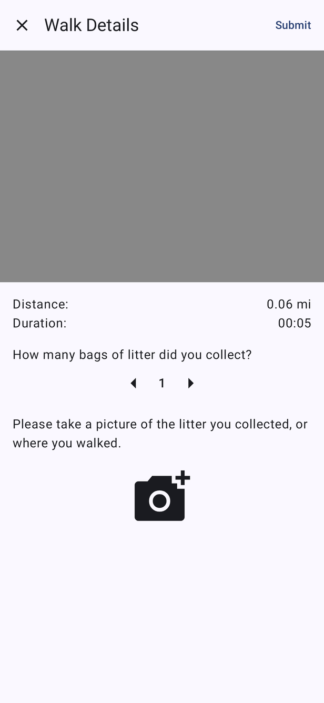
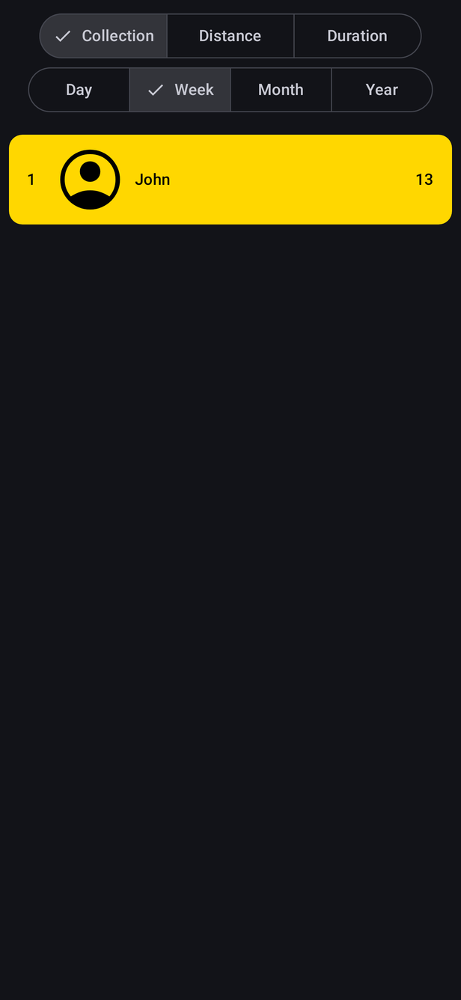
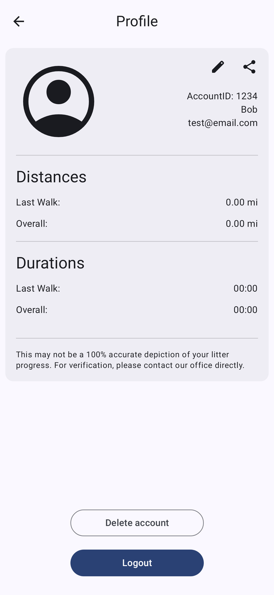
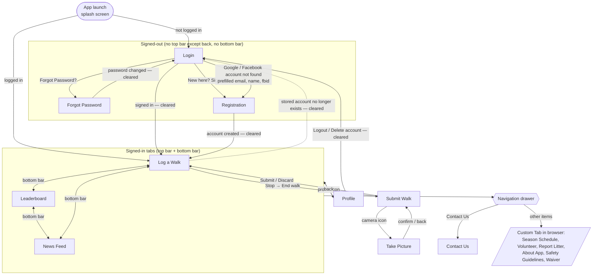
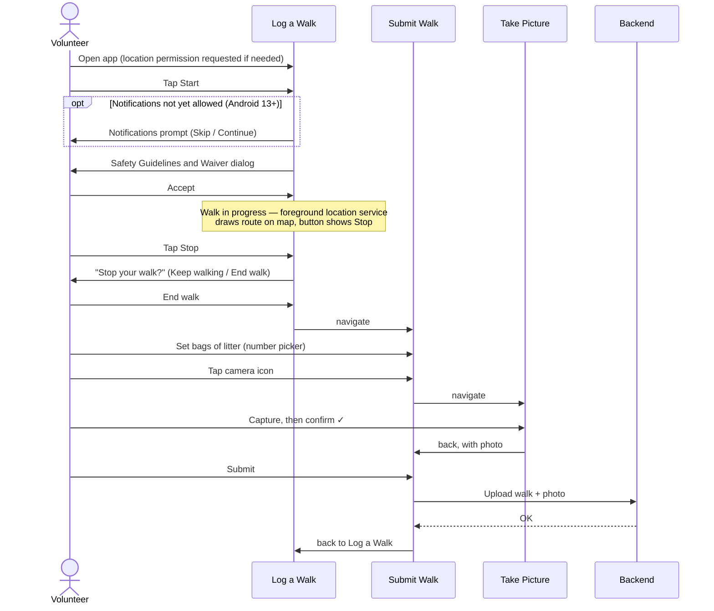

# Android App — Frontend Design

This folder documents how the Walking For Rochester Android app looks and how the user moves between screens. It is the reference for the Android UI and for keeping the iOS app consistent with it.

- **UI toolkit:** Jetpack Compose + Material 3, single activity (`MainActivity`), Navigation Compose
- **App version documented:** 2.3.3 (versionCode 33)
- **Screenshots:** rendered from the app's own `@Preview` composables (see [How the screenshots were made](#how-the-screenshots-were-made)). They use sample data, and Google Maps / camera areas show as grey placeholders.

## Contents

| Page | What it covers |
|---|---|
| [App shell & navigation](screens/app-shell.md) | Top bar, bottom bar, navigation drawer, dark mode, offline overlay |
| [Login](screens/login.md) | Email/password, Google and Facebook sign-in |
| [Registration](screens/registration.md) | Sign up form |
| [Forgot password](screens/forgot-password.md) | Three-step reset: request code → verify code → new password |
| [Log a Walk](screens/log-a-walk.md) | Home screen: map, Start/Stop, permission and safety dialogs |
| [Submit Walk](screens/submit-walk.md) | Walk summary, bags of litter, photo, submit or discard |
| [Take Picture](screens/take-picture.md) | In-app camera: capture → confirm |
| [Leaderboard](screens/leaderboard.md) | Rankings by collection, distance or duration, per period |
| [News Feed](screens/news-feed.md) | Embedded WordPress news page |
| [Profile](screens/profile.md) | Stats, edit profile, share, logout, delete account |
| [Contact Us & web links](screens/contact-and-links.md) | Contact screen and drawer links that open in Custom Tabs |
| [Shared components](components.md) | Buttons, text fields, dialogs, number picker, permission prompts |
| [Theme](theme.md) | Colors, typography, light/dark behavior |

## At a glance

## Screen map

All in-app destinations are declared in `ui/composable/navigation/Destination.kt` and wired up in `NavigationHost.kt`. A "cleared" arrow means the back stack is reset (`navigateAndClearBackStack(clearToRoot = true)`), so the back button cannot return to the previous screen.

### Which chrome each screen shows

From the flags on each `Destination`:

| Screen | Route | Top bar | Bottom bar | Top-left button | Profile icon | Drawer swipe |
|---|---|---|---|---|---|---|
| Login | `login` | — | — | — | — | — |
| Forgot Password | `forgotPassword` | ✓ | — | Back | — | — |
| Registration | `registration?email=&fname=&lname=&fbid=` | ✓ | — | Back | — | — |
| Log a Walk | `logAWalk` | ✓ | ✓ | Menu | ✓ | off (so the map can be panned) |
| Leaderboard | `leaderboard` | ✓ | ✓ | Menu | ✓ | ✓ |
| News Feed | `newsFeed` | ✓ | ✓ | Menu | ✓ | — |
| Profile | `profile` | own header | — | Back | — | — |
| Submit Walk | `submitWalk` | own header | — | Close (✕) | — | — |
| Take Picture | `takePicture` | full-screen camera | — | Back arrow | — | — |
| Contact Us | `contactUs` | ✓ | — | Back | — | — |

## Main task: logging a walk

If the user taps **Submit** without a photo, a "photo required" dialog appears. Pressing **✕** or system back shows a "Discard walk" confirmation. If a fake (mock) GPS location is detected during a walk, the walk ends and a "Spoof location detected" dialog appears.

## How the screenshots were made

Screens were rendered on the JVM with [Roborazzi](https://github.com/takahirom/roborazzi) + [ComposablePreviewScanner](https://github.com/sergio-sastre/ComposablePreviewScanner) on Robolectric (Pixel-class 411×891dp, xxhdpi, saved at half resolution). This needs no device, account or backend. The tooling was added only to generate the images and then removed from the build. To refresh the images:

1. Add `org.robolectric:robolectric`, `io.github.takahirom.roborazzi:roborazzi` / `roborazzi-compose` and `io.github.sergio-sastre.ComposablePreviewScanner:android` as `testImplementation`, plus `testOptions.unitTests.isIncludeAndroidResources = true`.
2. Add a parameterized Robolectric test that scans `…android.ui.composable` with `includePrivatePreviews()` and captures each preview. Wrap content in `LocalInspectionMode provides true`, and stub `CameraUpdateFactory` so the map screens can compose.
3. Run `./gradlew :app:testDebugUnitTest -Droborazzi.test.record=true`.

Known limits: Google Maps, the CameraX viewfinder and WebViews (News Feed) don't render off-device. On Android 12+ the app uses dynamic (wallpaper-based) color, so real devices will show different accent colors from these screenshots (see [Theme](theme.md)).
