# Shared components

[← Design index](README.md) · `ui/composable/common/`

Reusable Compose building blocks used across the screens. Reuse these rather than raw Material components so styling stays consistent.

## WFRButton / WFROutlinedButton — `WFRButton.kt`

Pill-shaped primary (filled) and secondary (outlined) buttons. Used for Sign In, Request code, Save/Cancel, Logout/Delete account, and so on. Both support a loading state that shows a spinner in place of the label.

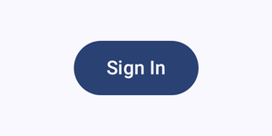
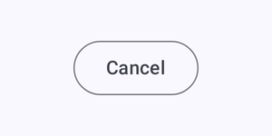

## WFRTextField — `WFRTextField.kt`

A Material text field wrapper with:

- a clear (ⓧ) trailing icon when the field has text
- a show/hide eye toggle for password fields
- inline validation: error label color, outline and supporting text (see [Registration](screens/registration.md))

There are three variants: `WFRTextField` (filled), `WFRPasswordField` (filled with an eye toggle and no clear icon) and `WFROutlinedTextField` (used on Profile edit).

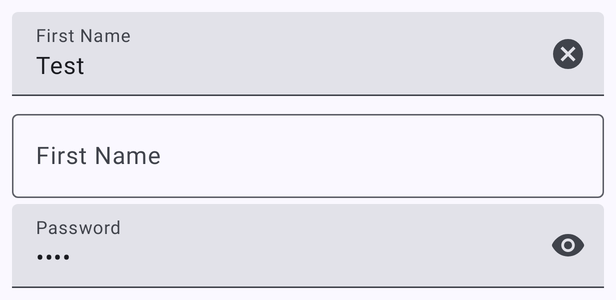 
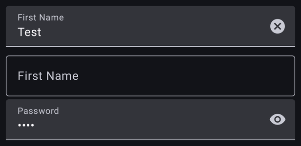

## HorizontalNumberPicker — `HorizontalNumberPicker.kt`

◀ value ▶ stepper used for "bags of litter" on Submit Walk.

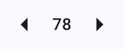

## CommunityServiceCheckbox — `CommunityServiceCheckbox.kt`

Label plus checkbox for opting into community service hours tracking. Used on Registration and Profile edit.

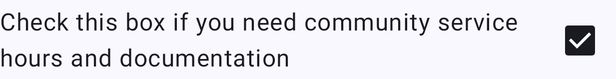

## WFRDialog — `WFRDialog.kt`

Generic alert dialog (not used by any screen yet): an optional icon (when present, the title is centered), title, body, and dismiss/confirm buttons.

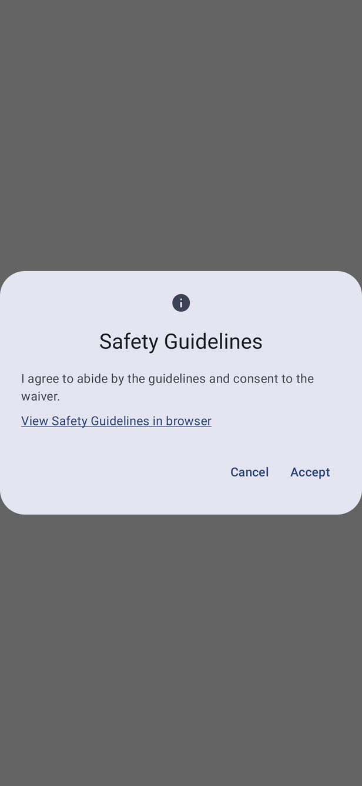
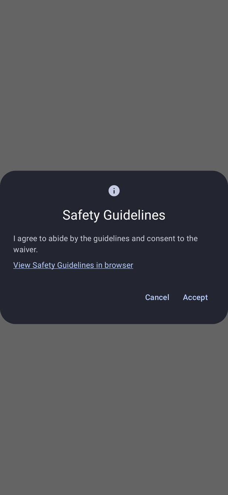

## Permission rationale dialogs — `Permissions.kt`

Shown before or after the OS permission prompt to explain why a permission is needed. If the user has already declined, the confirm action becomes **Settings** and opens the app's system settings.

| Location (required) | Notifications (optional) | Camera (for walk photo) |
|---|---|---|
| 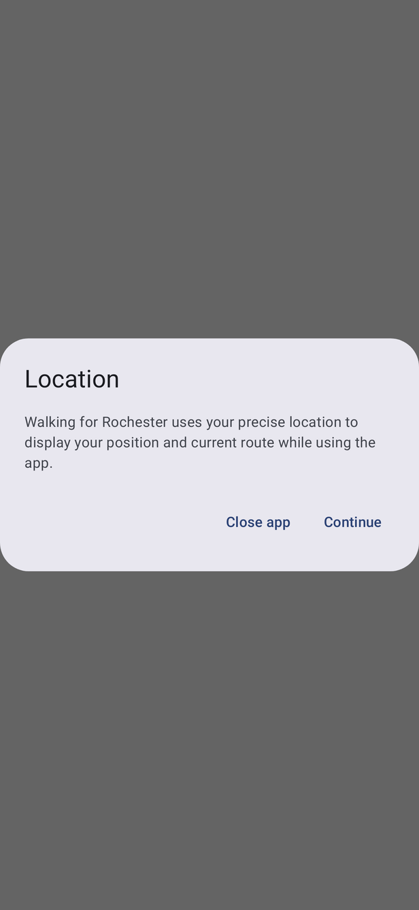 | 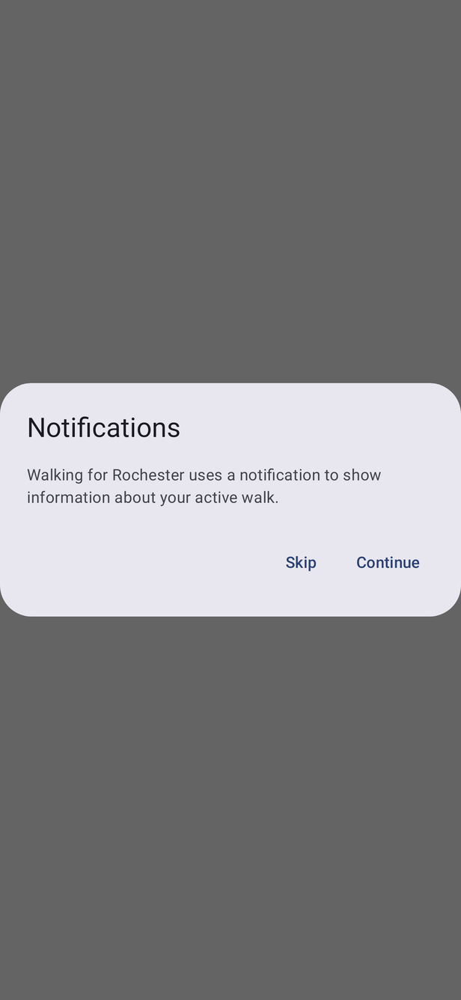 | 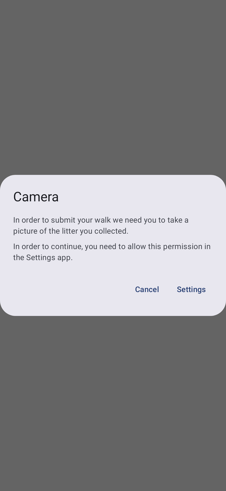 |
| Close app / Continue | Skip / Continue. Skipping still starts the walk. | Cancel / Settings |

## Other

- **WFRWebView** (`WFRWebView.kt`): embedded WebView used by News Feed
- **ConnectivityUtil** (`ConnectivityUtil.kt`): network observer and the full-screen no-connection overlay
- **Social login buttons** (`login/SocialButtons.kt`): white Google pill and blue Facebook pill

 

