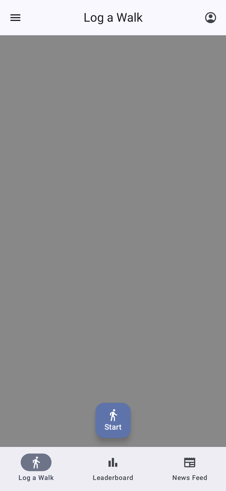
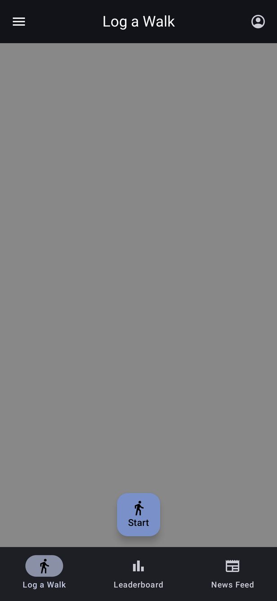
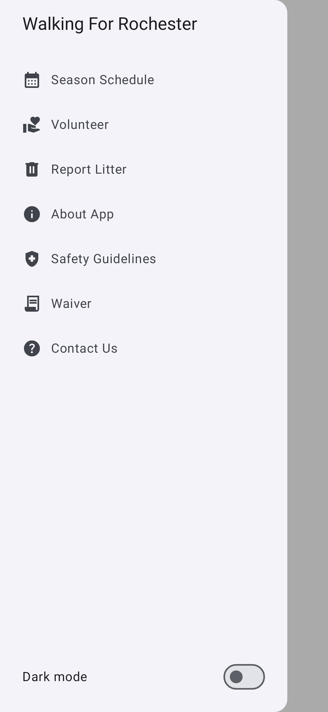
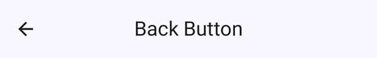
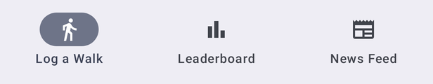
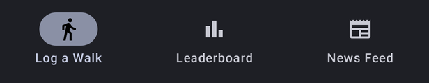
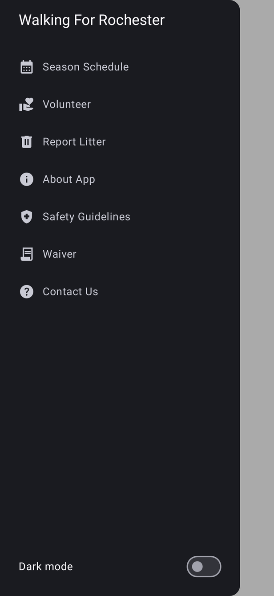

# App shell & navigation

[← Design index](../README.md)

Every signed-in screen sits inside one shell, `WalkingForRochesterAppScreen` (`ui/composable/common/WalkingForRochesterAppScreen.kt`). The shell is a modal navigation drawer around a Material 3 `Scaffold`. Each screen's `Destination` flags decide whether the top bar and bottom bar are shown.

## Top bar — `TopBar.kt`

A center-aligned top app bar showing the screen title.

- **Left:** ☰ opens the drawer on tab screens. ← (back) appears instead when `showBackButton = true` (Forgot Password, Registration, Contact Us).
- **Right:** the account icon opens **Profile** (`launchSingleTop`, so there is only ever one Profile on the stack).

 

## Bottom bar — `BottomBar.kt`

A Material 3 `NavigationBar` with three tabs: **Log a Walk**, **Leaderboard** and **News Feed**. It slides and fades in or out as you move between screens with and without it. Switching tabs pops back to Log a Walk first, so back from any tab returns to Log a Walk and then exits the app.

 

## Navigation drawer — `NavigationDrawer.kt`

Opened with ☰. Swipe-to-open is enabled only on Leaderboard. It is turned off on Log a Walk so it doesn't fight map panning.

| Item | Opens |
|---|---|
| Season Schedule | Custom Tab → walkingforrochester.org/all-litter-events |
| Volunteer | Custom Tab → volunteer sign-up form |
| Report Litter | Custom Tab → Survey123 litter report |
| About App | Custom Tab → walkingforrochester.org/about-_the_app |
| Safety Guidelines | Custom Tab → guidelines PDF (Google Docs viewer) |
| Waiver | Custom Tab → waiver form |
| Contact Us | In-app [Contact Us](contact-and-links.md) screen |

The **Dark mode** switch at the bottom is an in-app setting stored in preferences (`MainViewModel.onToggleDarkMode`). It does not follow the system theme. Custom Tabs are themed to match (`CustomTabsManager`).

## Other app-wide behavior

- **Splash screen:** shown until `MainViewModel` has loaded the saved login state, then the start screen is either Login or Log a Walk.
- **No connection overlay:** `NoConnectionOverlay` covers the whole app whenever the device has no network (`observeConnectivityAsFlow`).
- **Errors:** screens report unexpected errors with a snackbar from the shared `LocalSnackbarHostState`.
