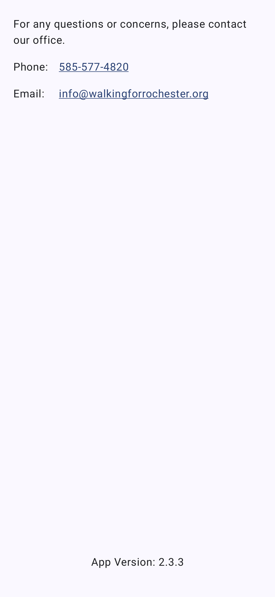

# Contact Us & web links

[← Design index](../README.md)

## Contact Us

Route `contactUs` · `ui/composable/contact/ContactUsScreen.kt`. Opened from the drawer. It has a top bar with a back button and no bottom bar.

- Tappable phone number (dialer) and email address (mail app)
- App version at the bottom (e.g. "App Version: 2.3.3")

## Drawer web links

The other drawer items are `Destination`s with a `uriTarget`. Instead of navigating inside the app, they open the URL in a Chrome Custom Tab themed to match the app's light/dark setting (`CustomTabsManager`). Some links are also opened from inside the app, such as the guidelines and waiver links in the Safety Guidelines dialog.

| Drawer item | String resource | URL |
|---|---|---|
| Season Schedule | `season_schedule_url` | https://walkingforrochester.org/all-litter-events/ |
| Volunteer | `volunteer_url` | https://links.walkingforrochester.org/widget/form/Q47Nt9QEMWrhrNFxpmeC |
| Report Litter | `report_litter_url` | Survey123 form |
| About App | `about_app_url` | https://walkingforrochester.org/about-_the_app/ |
| Safety Guidelines | `guidelines_url` | guidelines PDF via Google Docs viewer |
| Waiver | `waiver_url` | https://links.walkingforrochester.org/widget/form/LA27eLPPbgnxGtmJFZYK |

An "Our Story" item exists but is commented out in `Destination.kt`.
