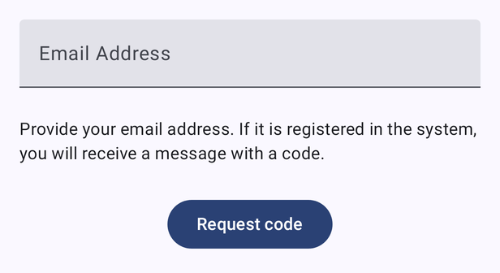
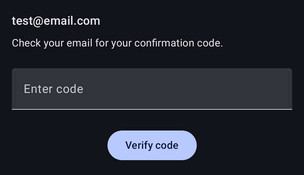
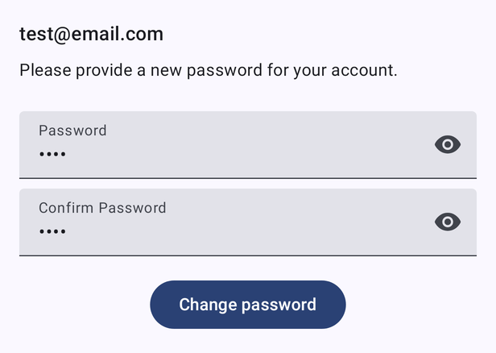
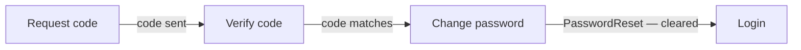

# Forgot password

[← Design index](../README.md) · Route `forgotPassword` · `ui/composable/forgotpassword/ForgotPasswordScreen.kt` · `ForgotPasswordViewModel`

A three-step flow on a single screen. Each step replaces the one before it. The top bar shows **Forgot Password** with a back button.

| 1. Request code | 2. Verify code | 3. Change password |
|---|---|---|
|  |  |  |
| Enter email → **Request code**. If the address is registered, a code is emailed. | Enter the code from the email → **Verify code** | Enter and confirm the new password → **Change password** |

Each field shows inline validation messages. A `loading` flag disables input while a request is in flight. `UnexpectedError` shows a snackbar.
