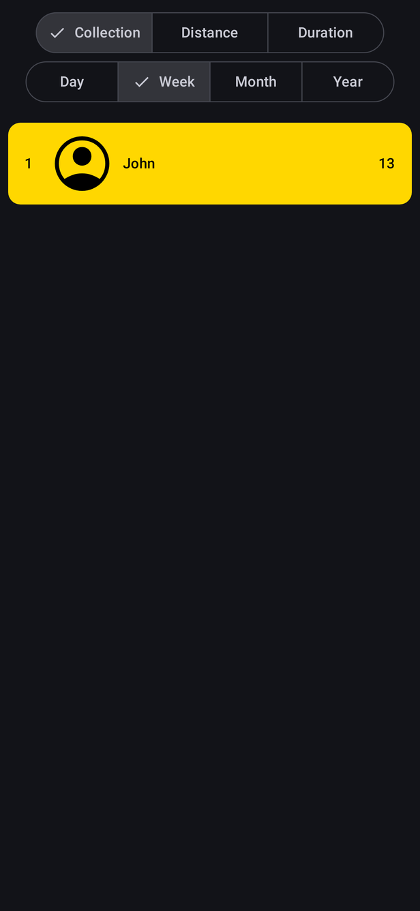
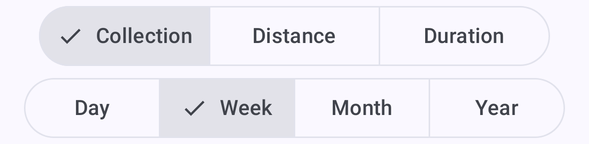
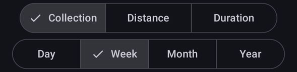
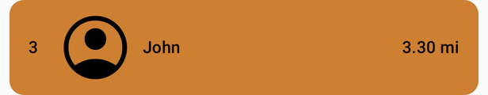

# Leaderboard

[← Design index](../README.md) · Route `leaderboard` · `ui/composable/leaderboard/` · `LeaderboardViewModel`

A bottom-bar tab ranking volunteers. Two segmented button rows at the top filter the list.

## Filters — `LeaderFilters.kt`

- **Type:** Collection (bags) · Distance (mi) · Duration (hh:mm). Default: Collection.
- **Period:** Day · Week · Month · Year. Default: Week.

 

## Leader cards — `LeaderCard.kt`

Each card shows the rank, profile picture, name and the value for the selected type. The top three cards are colored **gold** `#FFD700`, **silver** `#C0C0C0` and **bronze** `#CD7F32` with black text. The rest use `surfaceContainerHighest`.

## States

- Loading: a centered `CircularProgressIndicator`
- Empty: "No activity found for the specified filters"
- Error: "Unexpected error…" snackbar
