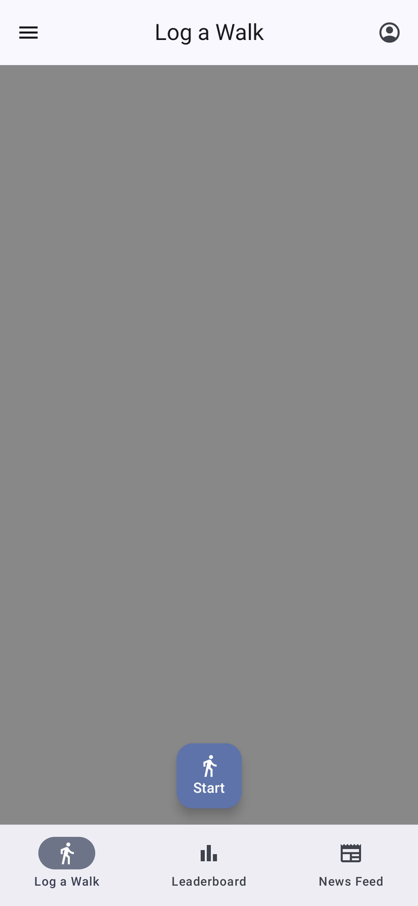
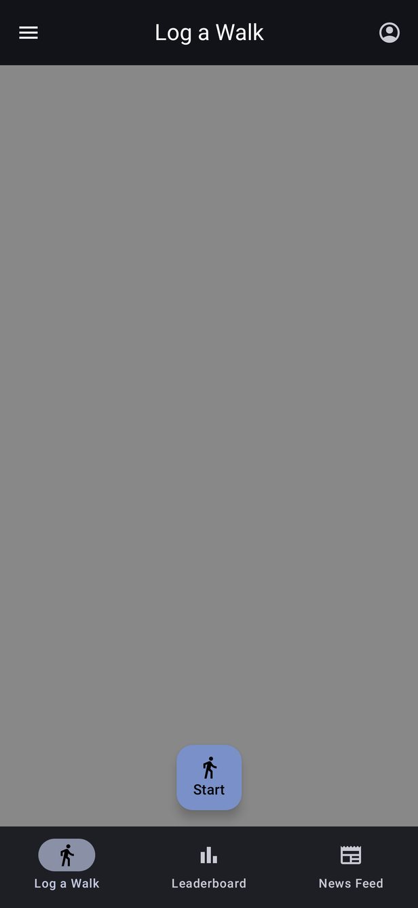
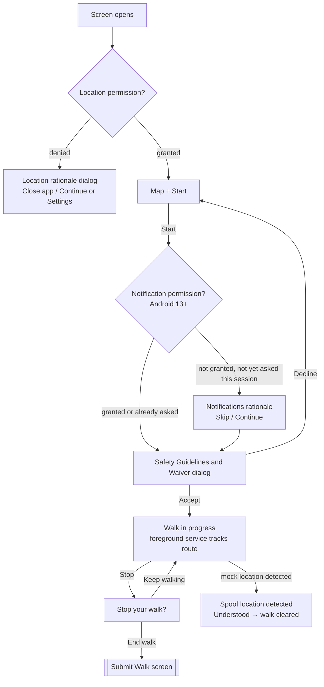
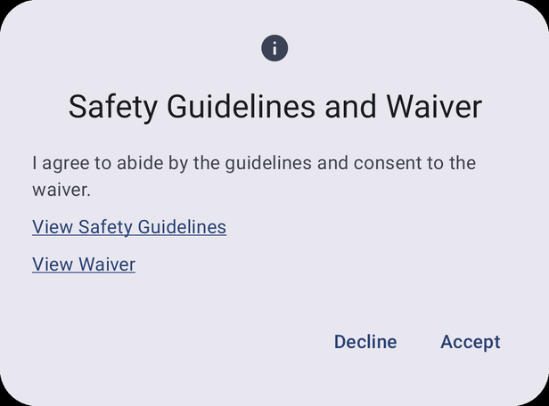
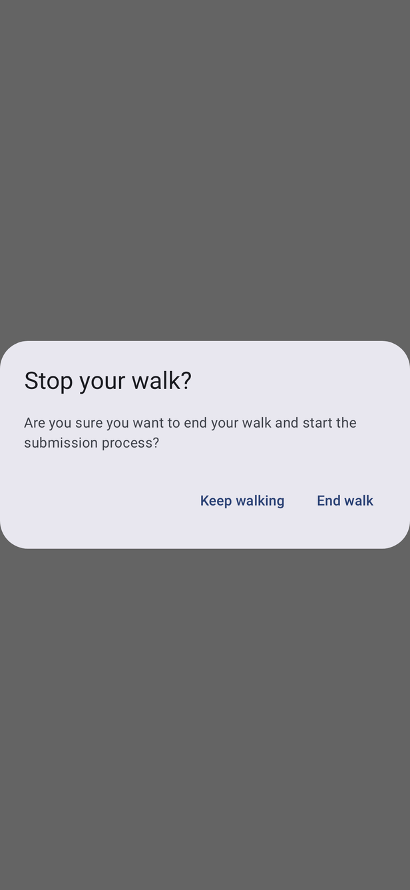
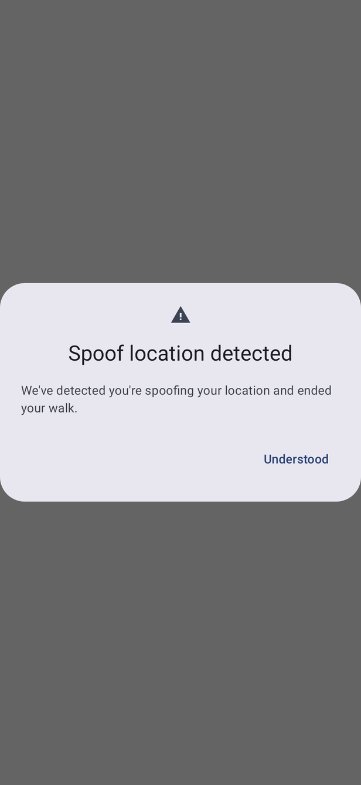

# Log a Walk (home)

[← Design index](../README.md) · Route `logAWalk` · `ui/composable/logawalk/` · `LogAWalkViewModel`, `ForegroundLocationService`

The signed-in home screen. A full-screen Google Map follows the user's location and draws the current walk route in `MapPathBlue` (`#0E54FF`), with start and end markers (`trip_origin`, `trip_destination_cap`). A large **Start / Stop** button floats at the bottom center. The map area is a grey placeholder in these screenshots.

| Idle | Walking | Dark |
|---|---|---|
|  |  |  |

The button (`StartStopWalk.kt`) shows a walking icon and **Start** when idle, and a finish-flag icon and **Stop** while walking. It only appears once location permission is granted.

## Starting a walk

## Dialogs on this screen

| Safety Guidelines and Waiver | Stop your walk? | Spoof location detected |
|---|---|---|
|  |  |  |
| Must be accepted before every walk. The links open the guidelines PDF and the waiver in a Custom Tab. | Confirms ending the walk. | Shown when `WalkState.MOCK_LOCATION_DETECTED`. The walk is discarded. |

The location and notification permission rationale dialogs are shown in [Shared components](../components.md#permission-rationale-dialogs).

## Other behavior

- An in-progress walk is recovered when the screen restarts (`recoverWalkingState`).
- On first display the app checks the saved account still exists (`validateProfile`). If it doesn't, the user is logged out to Login with the back stack cleared.
- `WalkCompleted` → [Submit Walk](submit-walk.md).
