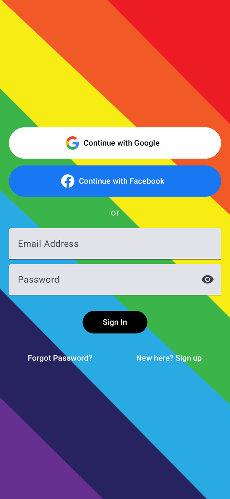
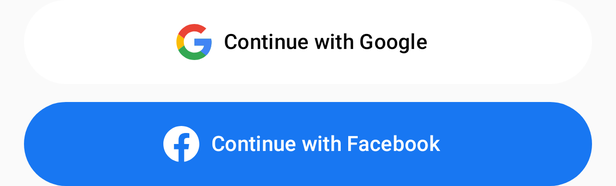

# Login

[← Design index](../README.md) · Route `login` · `ui/composable/login/` · `LoginViewModel`

The start screen when nobody is signed in. A full-bleed diagonal rainbow background (`rainbowbg.webp`) is shown with no top or bottom bar.

## Elements

1. **Continue with Google** (white pill), using Credential Manager (`GoogleCredentialUtil`)
2. **Continue with Facebook** (Facebook blue `#1877F2` pill), using the Facebook SDK
3. "or" divider
4. Email Address and Password fields (password has a show/hide eye toggle)
5. **Sign In** (black pill)
6. **Forgot Password?** and **New here? Sign up** text links

## Behavior

| Outcome (`LoginScreenEvent`) | Result |
|---|---|
| `LoginComplete` (Google/Facebook/saved credential) | Go to Log a Walk, back stack cleared |
| `LoginCompleteManual` (email + password) | Offer to save the password to Credential Manager, then go to Log a Walk |
| `NeedsRegistration` (social account with no WFR account) | Go to [Registration](registration.md) with email, first/last name and Facebook ID prefilled |
| `UnexpectedError` | Snackbar |

- Saved password credentials are offered automatically when the screen opens (`PasswordCredentialUtil.performPasswordSignIn`).
- The email field shows inline validation messages (`emailAddressValidationMessageId`). A failed login shows an authentication error message.
- **Forgot Password?** → [Forgot password](forgot-password.md). **Sign up** → [Registration](registration.md) with empty fields.
