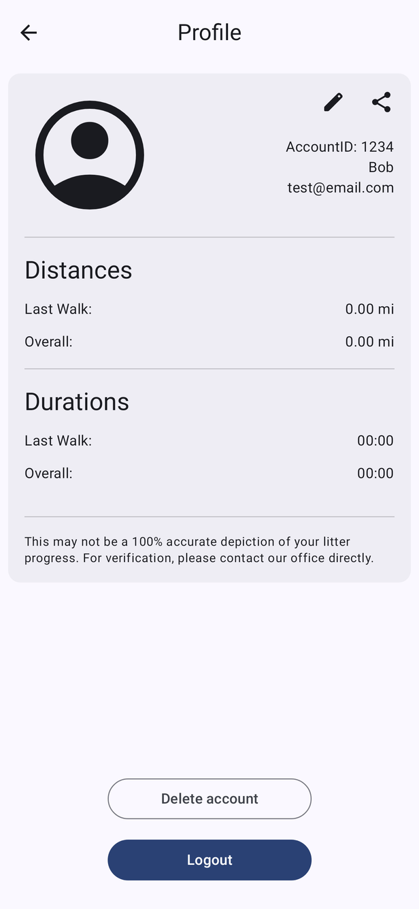
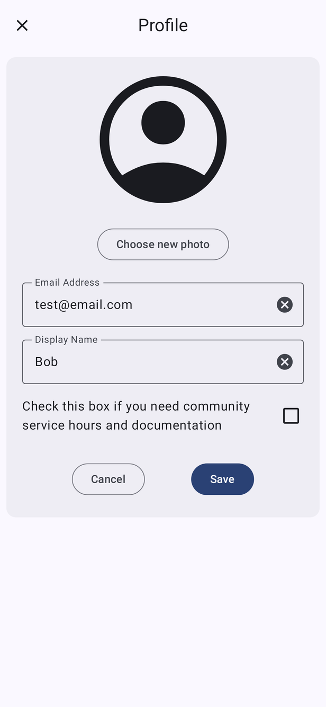
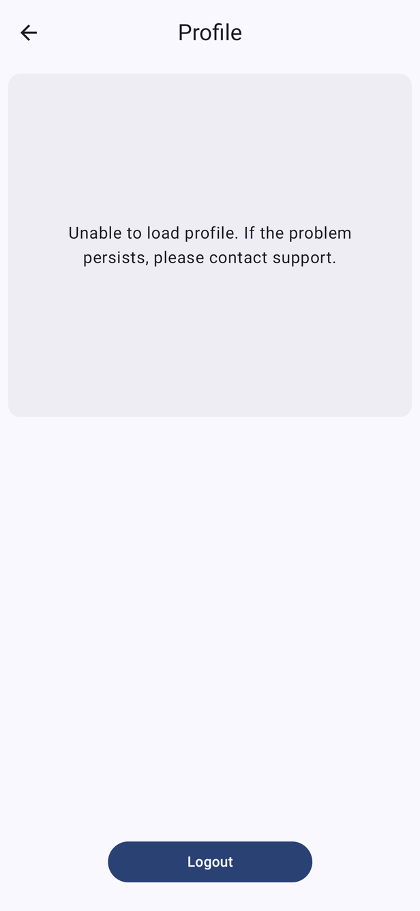
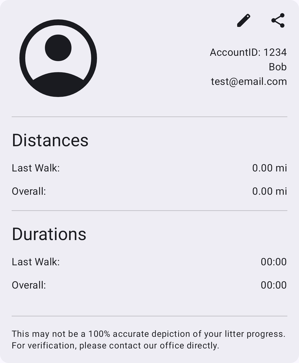
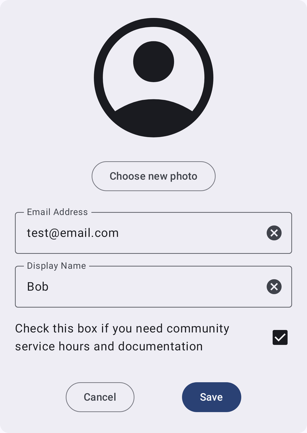
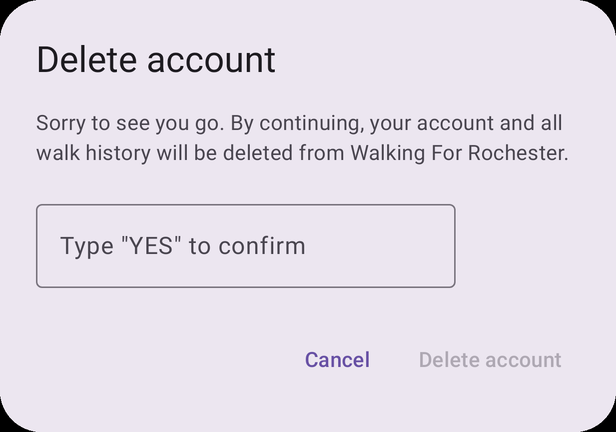
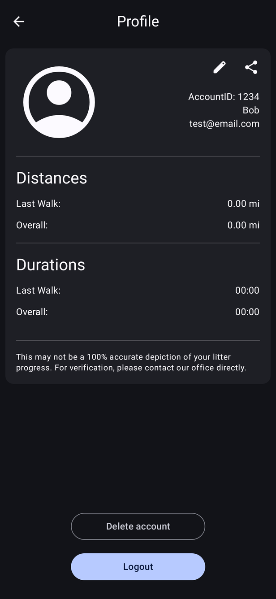
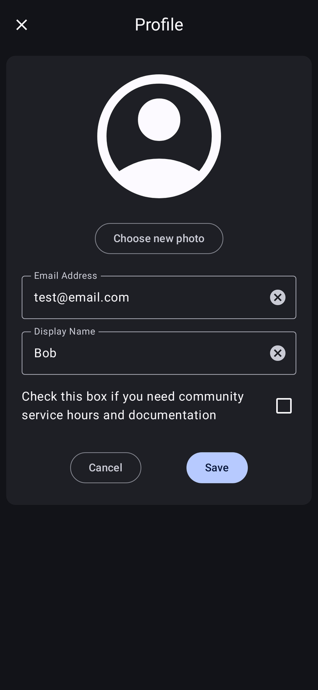

# Profile

[← Design index](../README.md) · Route `profile` · `ui/composable/profile/` · `ProfileViewModel`

Opened from the account icon in the top bar. It has its own header (← **Profile**) and no bottom bar.

| View | Edit | Load failed |
|---|---|---|
|  |  |  |

## View mode

- Profile picture, account ID, display name and email
- ✎ **Edit** and **Share** icons. Share opens the Android share sheet with the WFR logo and a text summary of the user's distance and duration stats.
- **Distances** and **Durations** sections showing the last walk and overall totals, with a disclaimer: "This may not be a 100% accurate depiction of your litter progress…"
- **Delete account** (outlined) and **Logout** (filled) buttons at the bottom

## Edit mode

The profile card changes to: **Choose new photo** (system photo picker, images only), Email Address, Display Name, the community service checkbox, and **Cancel** / **Save**. The email is checked for format and for whether it is already in use. Edit state survives process death (`SavedStateHandle`).

## Delete account

The user must type **YES** before **Delete account** is enabled. If the user has opted into community service tracking, an extra warning is shown. On success (`AccountDeleted`) or **Logout** the app goes to Login with the back stack cleared.

## Dark mode

