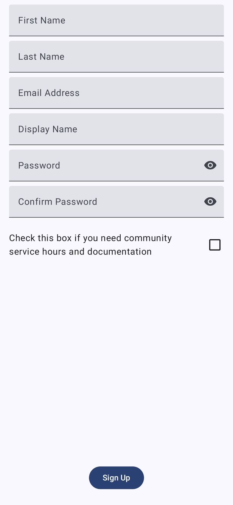
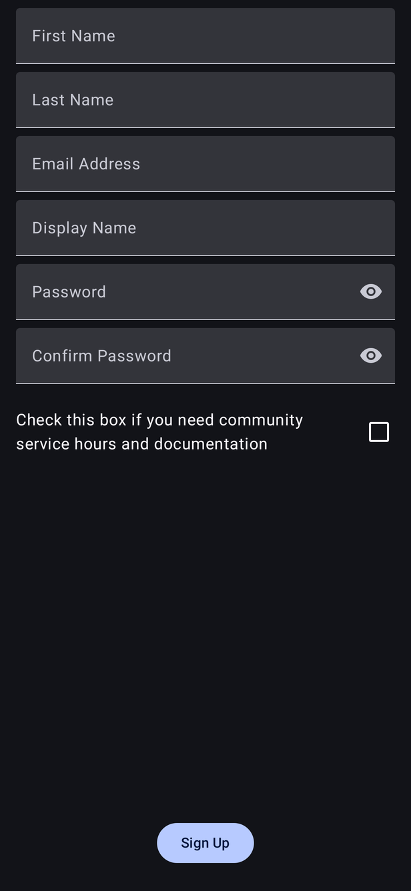
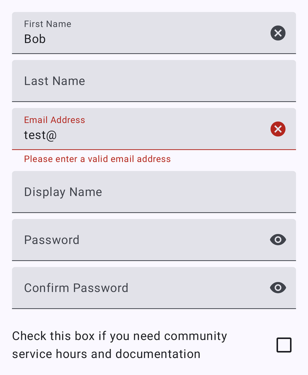

# Registration

[← Design index](../README.md) · Route `registration?email={email}&fname={fname}&lname={lname}&fbid={fbid}` · `ui/composable/registration/` · `RegistrationViewModel`

Account creation. Reached from Login with **Sign up**, or automatically after a Google/Facebook sign-in that has no matching account (fields are then prefilled). The top bar shows **Sign Up** with a back button.

## Fields

First Name, Last Name, Email Address, Display Name, Password, Confirm Password (both with show/hide), and the **community service** checkbox ("Check this box if you need community service hours and documentation"). A **Sign Up** button is pinned at the bottom.

Validation errors appear inline under the field, with a red outline, red label and error icon:

## Behavior

- `RegistrationComplete` → Log a Walk, back stack cleared (the user is signed in).
- `UnexpectedError` → snackbar.
- Back returns to Login.
