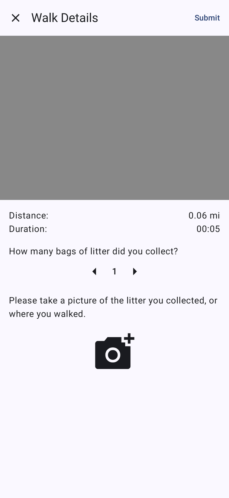
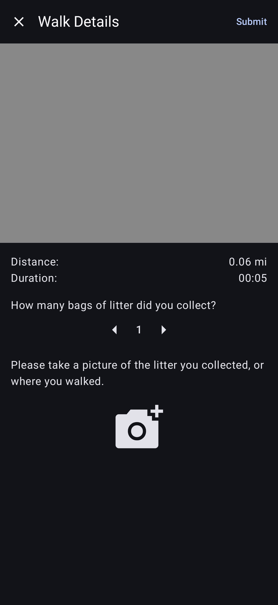
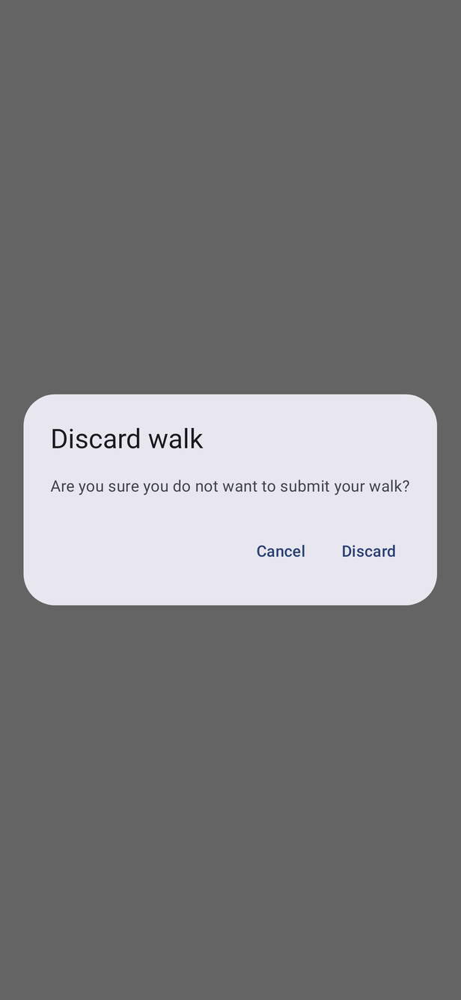
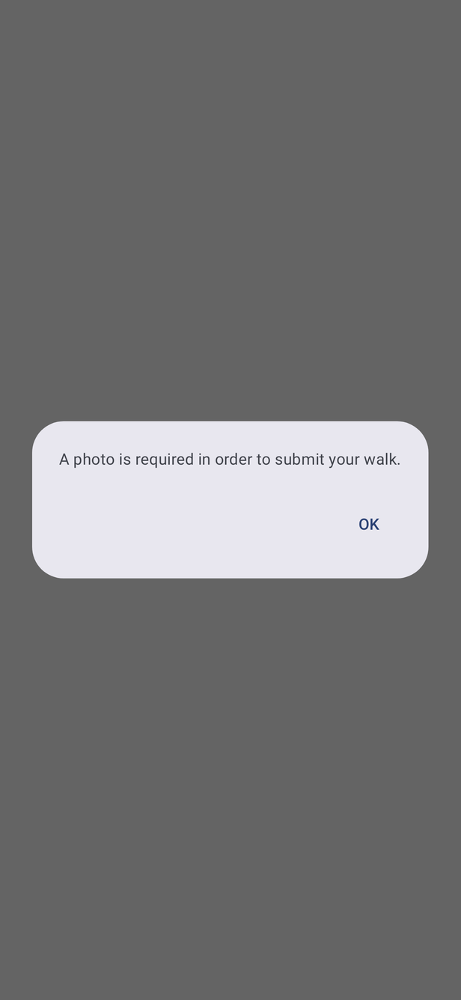

# Submit Walk

[← Design index](../README.md) · Route `submitWalk` · `ui/composable/submitwalk/` · `SubmitWalkViewModel`

Shown after the user ends a walk. It has its own top bar (**✕ Walk Details … Submit**) and no bottom bar.

## Layout

1. **Route map:** the walk's path fitted to its bounds (grey placeholder here). In portrait the map uses a 1.4:1 aspect ratio on phones and 2:1 on wider windows. In landscape or on expanded-width windows the map and details sit side by side.
2. **Distance** (miles) and **Duration**
3. "How many bags of litter did you collect?" with a [number picker](../components.md#horizontalnumberpicker)
4. "Please take a picture of the litter you collected, or where you walked." with a camera button. When a photo is taken it shows as a thumbnail in its place. The camera permission rationale is shown first if needed.

## Actions and dialogs

| Action | Result |
|---|---|
| **Submit** with a photo | Uploads the walk. The screen shows a progress state (`SubmissionInProgress`), then returns to Log a Walk (`WalkSubmitted`). |
| **Submit** without a photo | "Photo required" dialog |
| **✕** or system back | "Discard walk" confirmation. **Discard** → back to Log a Walk. |
| Camera button | [Take Picture](take-picture.md) |
| Upload fails | Snackbar: "An unexpected error occurred while submitting the walk…" |
| Location permission revoked meanwhile | Returns to Log a Walk |

