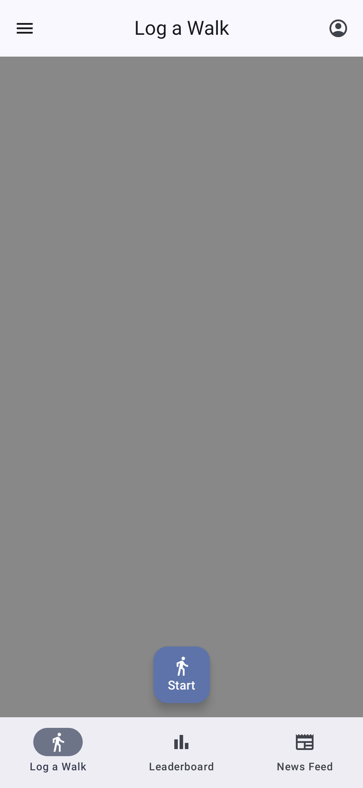
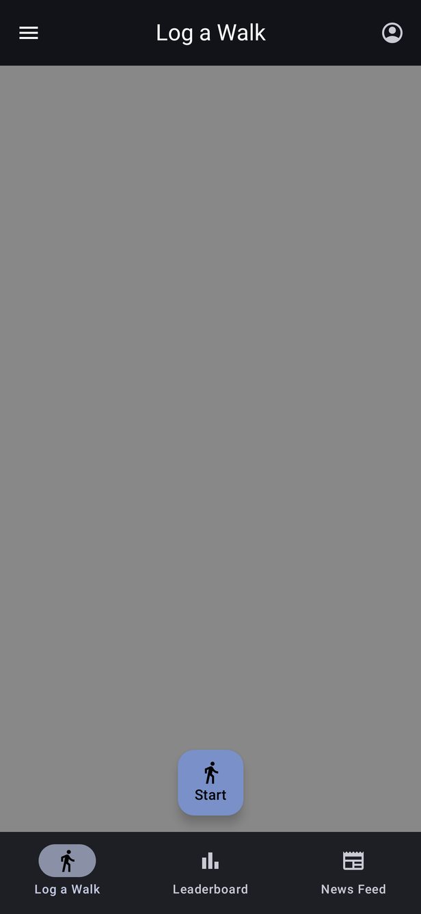

# Theme

[← Design index](README.md) · `ui/theme/` (`Theme.kt`, `Color.kt`, `Type.kt`), `res/values/colors.xml`

## Color scheme

`WalkingForRochesterTheme` uses **Material 3**:

| Condition | Color scheme |
|---|---|
| Android 12+ (default) | **Dynamic color** from the user's wallpaper (`dynamicLight/DarkColorScheme`) |
| Android 8–11, dark | `darkColorScheme(primary = #D0BCFF, secondary = #CCC2DC, tertiary = #EFB8C8)` |
| Android 8–11, light | Material 3 baseline `lightColorScheme()` (no overrides) |

So primary-colored elements (filled buttons, selected tab, links, switches) look different on each device. The screenshots in these docs show one example dynamic palette.

## Fixed brand and feature colors — `Color.kt`

These are used regardless of the color scheme. Keep `colors.xml` in sync with them.

| Token | Hex | Used for |
|---|---|---|
| `WFRGreen` | `#3BB54A` | Brand green (defined, not currently referenced) |
| `FacebookBlue` | `#1877F2` | Continue with Facebook button |
| `MapPathBlue` | `#0E54FF` | Walk route line on maps |
| `LeaderboardGold` | `#FFD700` | 1st place card |
| `LeaderboardSilver` | `#C0C0C0` | 2nd place card |
| `LeaderboardBronze` | `#CD7F32` | 3rd place card |
| `MaterialRed` | `#F44336` | Defined, not currently referenced |
| `MaterialGreen` | `#4CAF50` | Defined, not currently referenced |

The Login screen's rainbow background is an image (`drawable/rainbowbg.webp`), not a color token.

## Light / dark mode

Dark mode is an **in-app toggle** in the navigation drawer, saved in preferences. It is *not* taken from the system setting. `MainActivity` passes `uiState.darkMode` into the theme, and also sets status bar and navigation bar icon contrast and Custom Tab color scheme to match. Most screens have light and dark previews in these docs.

## Typography

The Material 3 default `Typography()` (Roboto on most devices). `Type.kt` has no overrides yet.

## Icons

Material Symbols vector drawables in `res/drawable` (`ic_*_24dp.xml`, plus a few 48dp), Google and Facebook brand marks (`ic_google.xml`, `ic_facebook.xml`), and map markers (`trip_origin.xml`, `trip_destination_cap.xml`).
